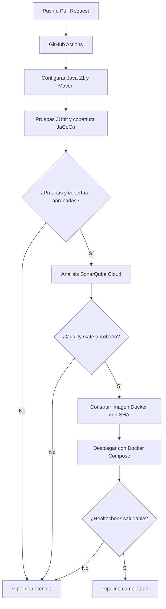
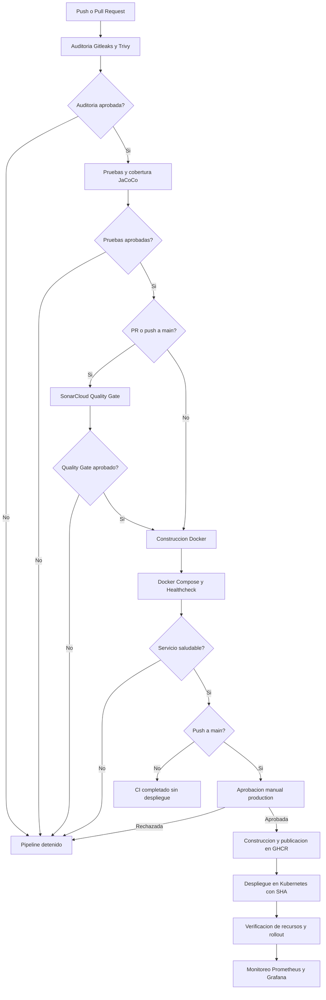
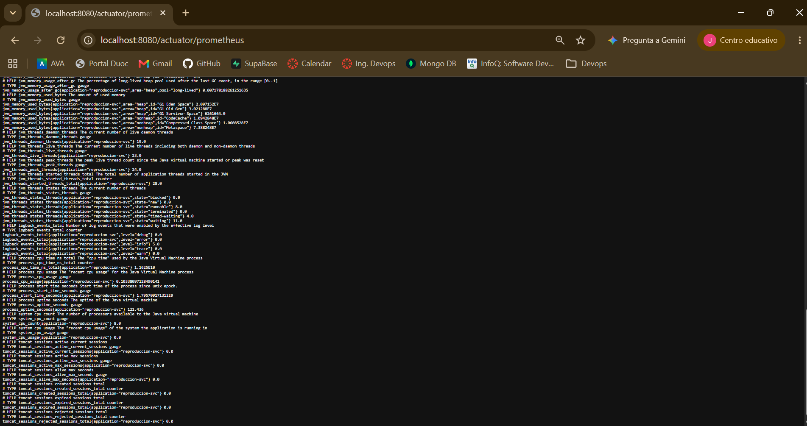
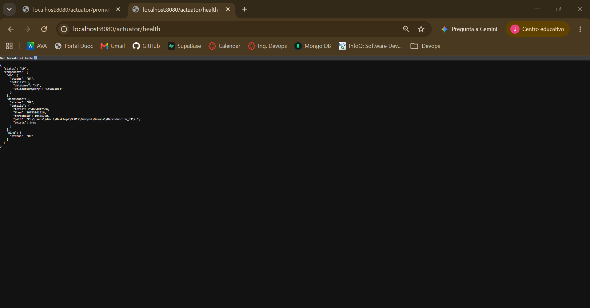

# Reproduccion de un Microservicio de riesgo reproduccion

Microservicio correspondiente al **caso 03 - StreamVerse**, Plataforma de streaming desarrollada para la **Evaluación Parcial N°1** de Ingeniería DevOps.

El servicio administra la información y la lógica asociada al dominio de **Reproducción**, aplicando principios de arquitectura de microservicios, integración continua, control de versiones y automatización de pruebas.

| Categoría | Tecnologías |
|-----------|-------------|
| Stack | Spring Boot 3.3 · Java 21 · Maven · Spring Data JPA · H2 · springdoc-openapi |
| Calidad | JaCoCo cobertura LINE 100% · Cucumber (BDD) alineado a endpoints REST |
| Entrega | Docker / Docker Compose |

---

## 🚀 Estrategia DevOps y Gestión del Repositorio

### 1. Estrategia de Branching: GitFlow (IE1)
Se selecciona **GitFlow** como estrategia de control de versiones debido a que el proyecto requiere un ciclo de vida estructurado con aislamiento total de nuevas funcionalidades (`feature/`), integración continua activa (`develop`), entregas estables a producción (`main`) y resolución rápida de incidentes en producción (`hotfix/`) sin interferir con el desarrollo en marcha.

### 2. Convención de Ramas y Commits (IE5)
* **Naming de Ramas:**
  * `main`: Código estable de producción.
  * `develop`: Base para integración continua.
  * `feature/<nombre>`: Nuevas características (ej. `feature/add-logging`).
  * `hotfix/<nombre>`: Parches críticos desde main (ej. `hotfix/fix-null-pointer`).
* **Conventional Commits:** Formato obligatorio `<tipo>(<alcance>): <descripción>`
  * `feat`: Nuevas funcionalidades.
  * `fix`: Correcciones de errores.
  * `docs`: Cambios en documentación.
  * `chore`: Configuración o mantenimiento.

### 3. Flujo de Merge y Code Review (IE2)
* Ningún cambio entra directamente a `main` o `develop`.
* Todo cambio se integra mediante **Pull Request (PR)** requiriendo al menos 1 revisión/aprobación por un par.

---

## Responsabilidad del microservicio (SRP)

Este microservicio administra exclusivamente los datos y la lógica correspondiente al dominio de Reproducción de StreamVerse, respetando el **Principio de Responsabilidad Única (SRP)**.
Utiliza una base de datos **H2 en memoria** independiente (un solo microservicio por base), manteniendo el aislamiento de los datos del dominio y evitando dependencias directas con bases de datos de otros servicios.

## Pagina de presentacion

Al ejecutar el servicio, `http://localhost:8080/` muestra la pagina de presentacion del microservicio con documentacion y enlaces a:

- **Swagger UI**: `/swagger-ui/index.html`
- **OpenAPI (yaml)**: `/v3/api-docs.yaml`
- **ReDoc**: `/redoc.html`
- **H2 Console**: `/h2-console`

## Endpoints

| Metodo | Ruta | Descripcion |
|--------|------|-------------|
| GET | `/api/reproducciones` | Lista todos los recursos |
| GET | `/api/reproducciones/{id}` | Obtiene un recurso por id |
| POST | `/api/reproducciones` | Crea un recurso |
| PUT | `/api/reproducciones/{id}` | Actualiza un recurso |
| DELETE | `/api/reproducciones/{id}` | Elimina un recurso |

##  Estrategia DevOps y Flujo de Trabajo

### 1. Modelo de Ramificación: GitFlow
Se adoptó el modelo **GitFlow** como estrategia de ramificación para mantener un desarrollo ordenado, trazable y predecible. Esto permite desarrollar nuevas funcionalidades de manera aislada mediante ramas (`feature/`), mantener un entorno de integración continua siempre activo (`develop`), mantener las versiones estables en (`main`) y aplicar correcciones de emergencia (`hotfix/`) sin interferir con el trabajo diario.

### 2. Convención para Ramas y Commits
* **Organización de Ramas:**
  * `main`: Producción y versiones estables.
  * `develop`: Integración continua de nuevas características.
  * `feature/<funcionalidad>`: Desarrollo de cambios específicos (ej. `feature/add-metrics`).
  * `hotfix/<incidencia>`: Correcciones críticas desde main (ej. `hotfix/fix-null-pointer`).
* **Mensajes de Commit (Standard Conventional Commits):**
  Usamos el formato `<tipo>(<alcance>): <descripción>`
  * `feat`: Nuevas características.
  * `fix`: Corrección de errores.
  * `docs`: Documentación.
  * `chore`: Mantenimiento y configuración del proyecto.

### 3. Flujo de Integración y Revisión de Código
Como estrategia de trabajo
* No se realizan modificaciones directamente sobre las ramas principales (`main` o `develop`).
* Los cambios se desarrollan en ramas independientes.
* Cada integración debe realizarse mediante un **Pull Request (PR)**
* Los Pull Requests ejecutan automaticamente las varlidaciones configuradas en **GitHub Actions**
* Los cambios se fusionan una vez que las validaciones correspondientes se completan correctamente
Este flujo permite mantener trazabilidad sobre las modificaciones realizadas y detectar problemas antes de incorporar código a las ramas principales.

---

## Documentacion del proyecto

La documentacion completa esta en la carpeta [`docs/`](docs/):

- [`docs/00_Resumen.md`](docs/00_Resumen.md) El proposito, responsabilidad y tecnologias
- [`docs/01_Arquitectura.md`](docs/01_Arquitectura.md) Los componentes, arquitectura y patrones
- [`docs/02_API.md`](docs/02_API.md)  contrato REST y ejemplos curl
- [`docs/03_Pruebas.md`](docs/03_Pruebas.md) Los tests unitarios, cobertura y Cucumber
- [`docs/04_Despliegue.md`](docs/04_Despliegue.md)
- [`docs/05_Justificacion.md`](docs/05_Justificacion.md) La justificacion del servicio: RF/RNF/seguridad cubiertos, stack y por que de cada tecnologia AWS
- [`docs/diagramas/`](docs/diagramas/)  C4 (contexto, contenedores, componentes), secuencia e infraestructura AWS Docker, Docker Compose e integración

## Como ejecutar localmente

```bash
mvn spring-boot:run
```

## Como ejecutar con Docker

```bash
docker compose up --build
# http://localhost:8080
```

## Como ejecutar las pruebas

```bash
mvn test      # Pruebas unitarias y Cucumber
mvn verify    # Verificación de cobertura JaCoCo
```

---

## Declaración de Uso Ético de IA e Integridad Académica

En cumplimiento con los lineamientos de la evaluación, se declara que las herramientas de inteligencia artificial (especificamente Gemini y Chatgpt) fueron empleadas exclusivamente como apoyo técnico para la mejora de redacción en la documentación, formato de archivos Markdown/UTF-8 y consulta de sintaxis de comandos en la terminal. Toda la lógica del pipeline de CI/CD, la resolución de conflictos en GitFlow, la ejecución de comandos y las decisiones técnicas presentadas en este repositorio fueron analizadas, ejecutadas y validadas de forma directa.

---

## Reflexión Personal Jorge Alvarez

Abordar este proyecto de DevOps con un microservicio real significó un cambio de mentalidad importante. Más allá de que el código Java ya viniera estructurado, el verdadero desafío fue en entender que el valor de un software no es solo que funcione en local, sino cómo se integra y despliega de forma segura. Durante el desarrollo, lo que más me marcó fue aplicar GitFlow en la práctica. Enfrentar la resolución manual de conflictos al hacer los merges entre ramas me ayudó a entender por qué existen estas metodologías en la industria y la importancia crítica de la trazabilidad a la hora de agregar nuevas funcionalidades. Ver cómo GitHub Actions automatizaba la compilación en Java 21 y la verificación de JaCoCo al 100% en cada Pull Request me dio una visión clara de lo que es la Integración Continua en un entorno profesional. 
Me quedo con un aprendizaje práctico sólido sobre administración de repositorios, estandarización de commits y automatización, entendiendo que la disciplina en el flujo de trabajo es lo que realmente garantiza la calidad en el desarrollo de software.
Firmado:  
Jorge Alvarez — Estudiante de Ingeniería DevOps  
Fecha: 05-09-2026

## Reflexión Personal Pamela Albanese

Este proyecto me ayudó a entender DevOps de una manera mucho más práctica, ya que varios conceptos que antes conocía principalmente desde la teoría tuvimos que aplicarlos realmente.
Una de las partes que más aprendizaje me dejó fue trabajar con GitFlow. Si bien por complicaciones personales no pude hacer integraciones directamente, pero en el trabajo de equipo, mantuve comunicación constante y fui testigo del proceso, junto a esto y a otros proyectos académicos, que se tuvo que practicar integración, me ha ayudado a entender la importancia de mantener organizados los cambios cuando varias personas trabajan sobre un mismo proyecto.
También me llamó bastante la atención ver GitHub Actions funcionando y cómo procesos como la compilación, las pruebas y la revisión de cobertura con JaCoCo podían ejecutarse automáticamente en cada Pull Request. Esto me permitió entender mucho mejor cómo funciona la Integración Continua en la práctica.
Creo que lo principal que me llevo de este trabajo es entender que desarrollar software no es solamente programar y lograr que funcione, sino también organizar bien el proceso, controlar los cambios y automatizar tareas para evitar errores. Hubo cosas que tuve que ir entendiendo mientras avanzaba, pero justamente eso me ayudó a aterrizar varios conceptos que antes conocía principalmente desde la teoría.
Firmado:  
Pamela Albanese — Estudiante de Ingeniería DevOps  
Fecha: 05-09-2026


---

# Evaluación Parcial N°2 — Pipeline CI/CD

## 1. Integración continua con GitHub Actions

El pipeline se encuentra configurado en `.github/workflows/ci.yml`.

Se ejecuta automáticamente cuando se realiza un push a `develop` o `main`, y cuando se crea o actualiza un Pull Request hacia estas ramas.

### Etapas del pipeline

1. **Preparación:** descarga el código y configura Java 21 con Maven.
2. **Pruebas:** ejecuta las pruebas automatizadas y verifica la cobertura con JaCoCo.
3. **Análisis de calidad:** ejecuta SonarQube Cloud y comprueba el Quality Gate.
4. **Construcción Docker:** construye una imagen identificada con el SHA del commit.
5. **Despliegue simulado:** levanta el microservicio mediante Docker Compose.
6. **Verificación:** comprueba que el contenedor alcance un estado saludable.

### Diagrama del pipeline CI/CD



---

## 2. Contenedores Docker

El proyecto utiliza un `Dockerfile` multi-stage, que separa la compilación y la ejecución del microservicio.

- **Primera etapa:** utiliza Maven y Java 21 para compilar la aplicación.
- **Segunda etapa:** utiliza una imagen Java 21 JRE basada en Alpine para ejecutar el archivo JAR.
- **Seguridad:** ejecuta la aplicación con un usuario sin privilegios (`appuser`).
- **Puerto:** expone el puerto 8080.

La imagen se construye automáticamente desde GitHub Actions, utilizando el SHA del commit para identificar la versión generada.

---

## 3. Pruebas automatizadas

El microservicio utiliza pruebas automatizadas con JUnit y Maven.

El pipeline ejecuta el siguiente comando:

```bash
mvn -B clean verify
```

Este comando permite ejecutar las pruebas, generar el reporte de JaCoCo y verificar la cobertura mínima configurada.

### Resultados verificados

- 20 pruebas ejecutadas correctamente.
- Cobertura de líneas del 100 % en las clases incluidas en la verificación de JaCoCo.
- Reporte de cobertura disponible en `target/site/jacoco/jacoco.xml`.

Si una prueba falla o no se cumple la cobertura mínima, el pipeline se detiene y no continúa con las siguientes etapas.

---

## 4. Seguridad y calidad del código

### SonarQube Cloud

Se integró SonarQube Cloud al pipeline para analizar el código y verificar el cumplimiento del Quality Gate.

La integración utiliza:

- El secreto `SONAR_TOKEN` configurado en GitHub.
- El análisis mediante Maven.
- El reporte de cobertura generado por JaCoCo.
- La opción `-Dsonar.qualitygate.wait=true`.

Esta última configuración permite que GitHub Actions espere el resultado del Quality Gate.

Si el análisis falla o el Quality Gate no se aprueba, el pipeline se detiene antes de construir y desplegar la imagen Docker.

En la ejecución verificada se obtuvo el resultado:

`QUALITY GATE STATUS: PASSED`

### Dependabot

Se configuró `.github/dependabot.yml` para revisar semanalmente las actualizaciones de dependencias.

La configuración incluye:

- **Maven:** revisión de dependencias del proyecto.
- **GitHub Actions:** revisión de versiones de las acciones utilizadas en el pipeline.

Ambas revisiones están programadas con frecuencia semanal (`weekly`).

### Política de bloqueo

El pipeline impide continuar con la construcción y el despliegue cuando:

- Fallan las pruebas automatizadas.
- No se cumple la cobertura mínima configurada.
- Falla el análisis de SonarQube o su Quality Gate.

---

## 5. Despliegue automatizado y trazabilidad

El despliegue se ejecuta automáticamente después de superar las verificaciones de pruebas y calidad.

### Construcción de la imagen

GitHub Actions construye una imagen Docker utilizando el SHA del commit:

```bash
docker build -t duoc/caso03-reproduccion:${GITHUB_SHA} .
```

Esto permite relacionar la imagen construida con una versión específica del código.

### Despliegue simulado

La imagen construida recibe también la etiqueta utilizada por Docker Compose:

```bash
docker tag duoc/caso03-reproduccion:${GITHUB_SHA} duoc/caso03-reproduccion:1.0.0
```

Posteriormente, se ejecuta:

```bash
docker compose up -d --no-build
```

El parámetro `--no-build` permite utilizar la imagen ya construida, evitando generar otra durante el despliegue.

### Verificación del despliegue

El pipeline revisa el estado del contenedor mediante su healthcheck.

Si el servicio alcanza el estado `healthy`, la verificación se completa correctamente.

Si el servicio presenta errores o no alcanza el estado saludable dentro del tiempo establecido, el pipeline falla.

### Trazabilidad

Los cambios y resultados pueden consultarse mediante:

- Historial de commits y Pull Requests.
- Ejecuciones de GitHub Actions.
- Resultados de las pruebas y análisis de calidad.
- Identificación de la imagen Docker mediante el SHA del commit.
- Registros del despliegue simulado.

**Importante:** el despliegue se realiza en el entorno temporal de GitHub Actions y no corresponde a un despliegue permanente en producción.

---

## 6. Orquestación con Docker Compose

Se utiliza `docker-compose.yml` para configurar y ejecutar el microservicio en un contenedor.

La configuración incorpora:

- Exposición del puerto 8080.
- Límites y reservas de recursos.
- Política de reinicio `unless-stopped`.
- Healthcheck para verificar el estado de la aplicación.
- Ejecución del servicio mediante una imagen Docker.

### Recursos configurados

| Recurso | Reserva | Límite |
|---------|---------|--------|
| CPU | 0.25 | 0.75 |
| Memoria | 256 MB | 512 MB |

### Healthcheck

El servicio utiliza una comprobación de salud con los siguientes parámetros:

- Intervalo: 30 segundos.
- Tiempo máximo de respuesta: 5 segundos.
- Reintentos: 3.
- Período inicial de espera: 40 segundos.

La configuración permite comprobar el funcionamiento del microservicio durante el despliegue simulado.

Actualmente se utiliza una instancia del contenedor, con límites de recursos definidos.

---

## 7. Verificación del pipeline

Durante las pruebas de integración se verificó:

- Ejecución correcta de las pruebas automatizadas.
- Generación y validación de cobertura JaCoCo.
- Análisis de SonarQube Cloud aprobado.
- Construcción de la imagen Docker.
- Despliegue simulado con Docker Compose.
- Verificación satisfactoria del healthcheck.
- Ejecución completa de GitHub Actions con resultado exitoso.

Las evidencias de ejecución se encuentran en la pestaña **Actions** del repositorio.

---

## 8. Declaración de uso de IA

Durante esta evaluación utilizamos ChatGPT como apoyo para aclarar dudas, comprender algunos conceptos, revisar configuraciones y mejorar la documentación. También nos ayudó a proponer soluciones técnicas, que posteriormente revisamos y verificamos en el proyecto, además de permitirnos profundizar nuestro aprendizaje a través de la interacción.

---

## 9. Reflexiones individuales - PAMELA ALBANESE - 06/11/2026

Sigo manteniendo mi postura de la evaluación anterior, pero esta vez agregaría que me parece impresionante darme cuenta de cómo acciones que pueden parecer tan pequeñas son capaces de prevenir grandes problemas que podrían presentarse en un entorno de producción.

También destaco el trabajo en equipo y la coordinación que logramos mantener durante esta evaluación, considerando que ambos tenemos responsabilidades y situaciones personales fuera del ámbito académico que debemos compatibilizar con nuestros estudios.

## 10. Reflexión - Jorge Alvarez - 06/11/2026

Enfrentar la entrega del microservicio `reproduccion-svc` me permitió consolidar el paso de la teoría a la práctica en un entorno DevOps real. El principal valor no estuvo solo en el código Java 21, sino en asegurar la infraestructura, la calidad y la automatización del despliegue.

Resolver los conflictos de integración en GitFlow como el ajuste de codificación UTF-8 y la limpieza del `pom.xml` al fusionar `feature/docker-setup` con `develop` reafirmamos la importancia del control de versiones. Además, la creación del `Dockerfile` multietapa con usuario no-root (`appuser`) y la orquestación en `docker-compose.yml` me permitieron aplicar estándares profesionales de contenerización y seguridad.
---

# Evaluación Parcial N°3 — Observabilidad, seguridad y cumplimiento

## 1. Pipeline CI/CD integrado

Se incorporaron controles de seguridad al pipeline de la
evaluación anterior, junto con el despliegue condicionado
en Kubernetes (k3s) sobre Azure.

### Diagrama del pipeline


## 2. Políticas de seguridad y cumplimiento

| Política | Herramienta | Mecanismo de verificación |
|---|---|---|
| Protección del código fuente | GitHub Branch Protection | Pull Request y checks obligatorios en main. |
| Prevención de exposición de secretos | Gitleaks | Bloqueo del pipeline al detectar secretos. |
| Control de vulnerabilidades críticas | Trivy | Escaneo del sistema de archivos y bloqueo ante vulnerabilidades críticas detectadas. |
| Calidad y seguridad del código | SonarQube Cloud | Quality Gate obligatorio en PR y main. |
| Integridad de herramientas | SHA-256 y HTTPS | Verificación de archivos descargados antes de su instalación. |
| Calidad de las pruebas | JUnit y JaCoCo | Ejecución de pruebas y validación de cobertura. |
| Actualización de dependencias | Dependabot | Revisión semanal de dependencias. |
| Control de despliegue | GitHub Environments | Aprobación manual en el entorno production. |
| Trazabilidad de versiones | GitHub SHA y GHCR | Identificación de la imagen mediante el commit validado. |
| Disponibilidad del servicio | Docker Healthcheck y Kubernetes | Verificación de salud y estado del despliegue. |
| Observabilidad | Prometheus y Grafana | Recolección de métricas y visualización mediante dashboards. |

## 3. Auditoría de seguridad automatizada

Se incorporó el script `audit/security-audit.sh`, ejecutado
automáticamente mediante GitHub Actions.

- Gitleaks: detección de secretos expuestos.
- Trivy: detección de vulnerabilidades críticas en el sistema de archivos.

Si alguna herramienta devuelve un error, el pipeline se
detiene y no continúa con las etapas posteriores.

### Pruebas realizadas

| Prueba | Resultado |
|---|---|
| Ejecución inicial de la auditoría | Aprobada |
| Incorporación de un secreto ficticio | Detectado por Gitleaks |
| Bloqueo de la auditoría | Exit code 1 |
| Ejecución de build-and-test | Omitida (Skipped) |
| Eliminación del secreto ficticio | Realizada |
| Recuperación del pipeline | Aprobada |
| Quality Gate después de las correcciones | Aprobado |

Las evidencias se encuentran en GitHub Actions, en las
ejecuciones realizadas sobre la rama
`feature/compliace-security`.

La prueba permitió comprobar que la detección de un secreto
impide continuar con las etapas posteriores del CI.

La ejecución #69 de GitHub Actions en main validó el
despliegue condicionado tras superar los controles y
recibir la aprobación manual. La prueba del secreto
ficticio verificó el bloqueo de las etapas posteriores
del CI, no un intento de despliegue en main.

## 4. Protección de ramas y control de despliegue

### Protección de main

Se configuraron reglas de protección para impedir la
integración de cambios sin un Pull Request y sin aprobar
los siguientes controles obligatorios:

- Auditoria de seguridad.
- build-and-test.
- SonarCloud Code Analysis.

También se deshabilitó la posibilidad de omitir las reglas
de protección configuradas.

### Despliegue controlado en producción

El archivo `cd-k8s.yml` se configuró como un workflow
reutilizable mediante `workflow_call`.

El despliegue requiere:

- Auditoría de seguridad aprobada.
- Pruebas y cobertura aprobadas.
- Quality Gate aprobado.
- Verificación del microservicio con Docker Compose.
- Push a la rama main.
- Aprobación manual en el entorno production.

La imagen publicada en GHCR se identifica mediante el SHA
del commit validado y se utiliza para actualizar el
microservicio en Kubernetes.

La aprobación manual y el despliegue en producción
fueron validados exitosamente en la ejecución #69
de GitHub Actions, obteniendo un rollout exitoso
en Kubernetes, con dos réplicas disponibles en
estado Running y sin reinicios.

## 5. Instrumentación y observabilidad (IE1)

Se incorporó Spring Boot Actuator para obtener información
sobre el estado y comportamiento del microservicio,
integrando métricas compatibles con Prometheus.

### Endpoints habilitados

| Endpoint | Función |
|---|---|
| `/actuator/health` | Estado del servicio y sus componentes. |
| `/actuator/info` | Información de la aplicación. |
| `/actuator/metrics` | Consulta de métricas disponibles. |
| `/actuator/prometheus` | Exposición de métricas para Prometheus. |

### Evidencias de funcionamiento

Exposición de métricas de memoria JVM, CPU, hilos,
sesiones y registros de la aplicación.



Verificación del estado del microservicio, base de datos
H2, espacio en disco y ping, obteniendo estado UP.



---

## 6. Orquestación y despliegue en Kubernetes (IE2)

Se implementó el despliegue del microservicio mediante
k3s en una máquina virtual de Azure.

Los manifiestos se encuentran en la carpeta `k8s/`.

| Archivo | Función |
|---|---|
| `namespace.yaml` | Organización de recursos en streamverse. |
| `configmap.yaml` | Variables de configuración del servicio. |
| `deployment.yaml` | Administración de réplicas y recursos. |
| `service.yaml` | Exposición del microservicio mediante NodePort. |

### Configuración del despliegue

| Parámetro | Valor |
|---|---|
| Namespace | streamverse |
| Réplicas | 2 |
| Puerto del contenedor | 8080 |
| NodePort | 30080 |
| Perfil de Spring Boot | prod |
| Registro de imágenes | GitHub Container Registry |

### Recursos por contenedor

| Recurso | Solicitud | Límite |
|---|---|---|
| CPU | 150m | 500m |
| Memoria | 256Mi | 512Mi |

### Verificación de salud

Se configuraron dos mecanismos de verificación:

- Readiness Probe: determina si el contenedor está
  preparado para recibir solicitudes.
- Liveness Probe: verifica si el contenedor continúa
  funcionando y permite su reinicio ante fallos.

| Parámetro | Readiness | Liveness |
|---|---|---|
| Endpoint | /actuator/health/readiness | /actuator/health/liveness |
| Espera inicial | 20 segundos | 40 segundos |
| Intervalo | 10 segundos | 15 segundos |
| Umbral de fallos | 3 | 3 |

La configuración permite administrar la disponibilidad
del servicio mediante dos réplicas y comprobaciones
periódicas de salud.

---

## 7. Monitoreo con Prometheus y Grafana (IE3)

Se incorporó Prometheus para la recolección de métricas
y Grafana para su visualización.

El archivo `monitoring/prometheus.yml` establece:

- Intervalo de recolección: 15 segundos.
- Intervalo de evaluación: 15 segundos.
- Job: reproduccion-svc.
- Endpoint: /actuator/prometheus.

La configuración versionada utiliza un destino local
mediante host.docker.internal:8080.

El manifiesto de Kubernetes también incorpora anotaciones
para identificar el endpoint de métricas del microservicio.

### Servicios implementados

Según el registro de integración del commit 2b5c0d0,
se utilizaron los siguientes servicios:

| Servicio | Puerto |
|---|---|
| Microservicio | 30080 |
| Prometheus | 30090 |
| Grafana | 30300 |

Para la visualización se utilizó el dashboard JVM
identificado con el número 4701 de Grafana, según
el registro del mismo commit.

### Panel, decisión y acción operacional

| Panel o indicador | Decisión | Acción operacional |
|---|---|---|
| Consumo de CPU | Evaluar saturación del servicio. | Revisar límites de CPU y capacidad de procesamiento. |
| Memoria JVM | Identificar consumo elevado de memoria. | Revisar recursos asignados al contenedor. |
| Estado de salud | Determinar disponibilidad del servicio. | Revisar el estado de los pods y sus probes. |
| Hilos JVM | Identificar posibles problemas de concurrencia. | Revisar registros y comportamiento de la aplicación. |

Las acciones anteriores corresponden a criterios de
respuesta operacional definidos para el monitoreo.
No representan incidentes o intervenciones comprobadas.

---

## 8. Trazabilidad de la implementación

Los cambios de infraestructura, observabilidad y
seguridad quedaron registrados mediante commits y
Pull Requests.

| Pull Request | Implementación |
|---|---|
| #16 | Kubernetes, Azure, Actuator, Prometheus y Grafana. |
| #17 | Sincronización de main con develop. |
| #18 | Auditoría de seguridad e integración de controles CI/CD. |
| #19 | Integración final de develop a main y validación del despliegue mediante la ejecución #69. |

### Resultados de calidad

En el Pull Request #16, SonarQube Cloud registró:

- Quality Gate aprobado.
- 0 nuevos issues.
- 0 Security Hotspots.

Las verificaciones posteriores de seguridad y calidad
se encuentran registradas en GitHub Actions.

### Alcance de las evidencias

Las capturas disponibles en el repositorio permiten
verificar la exposición local de métricas y el estado
de salud del microservicio.

El despliegue en Azure y la puesta en marcha de
Prometheus y Grafana se encuentran registrados en
el commit de integración 2b5c0d0.
---

## 9. Declaración de uso de IA

Durante esta evaluación utilizamos ChatGPT como apoyo
para comprender conceptos, proponer y revisar
configuraciones, resolver errores del pipeline y
organizar la documentación.

Las configuraciones fueron implementadas y verificadas
mediante pruebas y ejecuciones en GitHub Actions.


## 9. Evidencias de la Evaluación Parcial N°3

### Observabilidad y monitoreo (IE1)

- [EV01 - Métricas Actuator y Prometheus](docs/evidencias_E3/EV1-actuator-prometheus.png)
- [EV02 - Estado de salud del microservicio](docs/evidencias_E3/EV2-actuator-health.png)

### Seguridad y cumplimiento (IE5)

- [EV03 - Quality Gate aprobado](docs/evidencias_E3/EV03-quality-gate-sonar.jpg.jpg)
- [EV04 - Ejecución de Gitleaks y Trivy](docs/evidencias_E3/EV04-ejecucion-gitleaks-trivy.jpg.jpg)
- [EV05 - Auditoría de seguridad aprobada](docs/evidencias_E3/EV05-auditoria-aprobada.jpg.jpg)
- [EV12 - Validaciones obligatorias en main](docs/evidencias_E3/EV12-validaciones-obligatorias-main.jpg.jpg)
- [EV17 - Bloqueo de actualización Dependabot](docs/evidencias_E3/EV17-dependabot-merge-bloqueado.jpg.jpg)
- [EV18 - Configuración de protección de main](docs/evidencias_E3/EV18-configuracion-proteccion-main.png.jpeg)
- [EV20 - Pull Request obligatorio](docs/evidencias_E3/EV20-main-pull-request-obligatorio.png.jpeg)

### Validación del pipeline y controles de despliegue (IE6)

- [EV06 - Pipeline inicial exitoso](docs/evidencias_E3/EV06-pipeline-inicial-exitoso.jpg.jpg)
- [EV07 - Prueba de secreto ficticio](docs/evidencias_E3/EV07-prueba-secreto-ficticio.jpg.jpg)
- [EV08 - Detección del secreto mediante Gitleaks](docs/evidencias_E3/EV08-gitleaks-secreto-detectado.jpg.jpg)
- [EV09 - Bloqueo del pipeline](docs/evidencias_E3/EV09-bloqueo-pipeline.jpg.jpg)
- [EV10 - Recuperación del pipeline](docs/evidencias_E3/EV10-recuperacion-pipeline.jpg.jpg)
- [EV11 - Validaciones del PR hacia develop](docs/evidencias_E3/EV11-validaciones-PR-develop.jpg.jpg)
- [EV13 - Espera de aprobación manual](docs/evidencias_E3/EV13-espera-aprobacion-produccion.jpg.jpg)
- [EV14 - Pipeline CI/CD exitoso](docs/evidencias_E3/EV14-pipeline-CD-exitoso.jpg.jpg)
- [EV19 - Configuración del entorno production](docs/evidencias_E3/EV19-configuracion-entorno-production.png.jpeg)

### Despliegue en Kubernetes (IE2)

- [EV15 - Rollout exitoso en Kubernetes](docs/evidencias_E3/EV15-rollout-kubernetes.jpg.jpg)
- [EV16 - Verificación de pods y servicio](docs/evidencias_E3/EV16-verificacion-pods-servicio.jpg.jpg)

---

## 10. Reflexiones individuales

### Reflexión personal - Pamela Albanese - 28/11/2026
Al finalizar esta tercera evaluación, creo que he logrado comprender mucho mejor la importancia de DevOps dentro del desarrollo de software. Si bien en las evaluaciones anteriores me llamó mucho la atención cómo la automatización nos permitía prevenir errores, en esta oportunidad pude llevar ese aprendizaje un poco más allá, incorporando medidas de seguridad y comprobando cómo estas pueden impedir que un cambio llegue a producción.

Una de las cosas que más destaco es que, durante el desarrollo de esta evaluación, nos encontramos con varios errores que tuvimos que ir comprendiendo y solucionando. Si bien esto nos tomó tiempo, considero que fue parte importante del aprendizaje, ya que no se trataba solamente de lograr que el pipeline funcionara, sino también de entender por qué fallaba.

Me quedo con la importancia de no considerar la seguridad como algo que se incorpora al finalizar un proyecto, sino como algo que debe estar presente durante todo su desarrollo. También destaco nuevamente el trabajo en equipo y la coordinación que logramos mantener durante las tres evaluaciones.

### Reflexión personal - Jorge Alvarez
